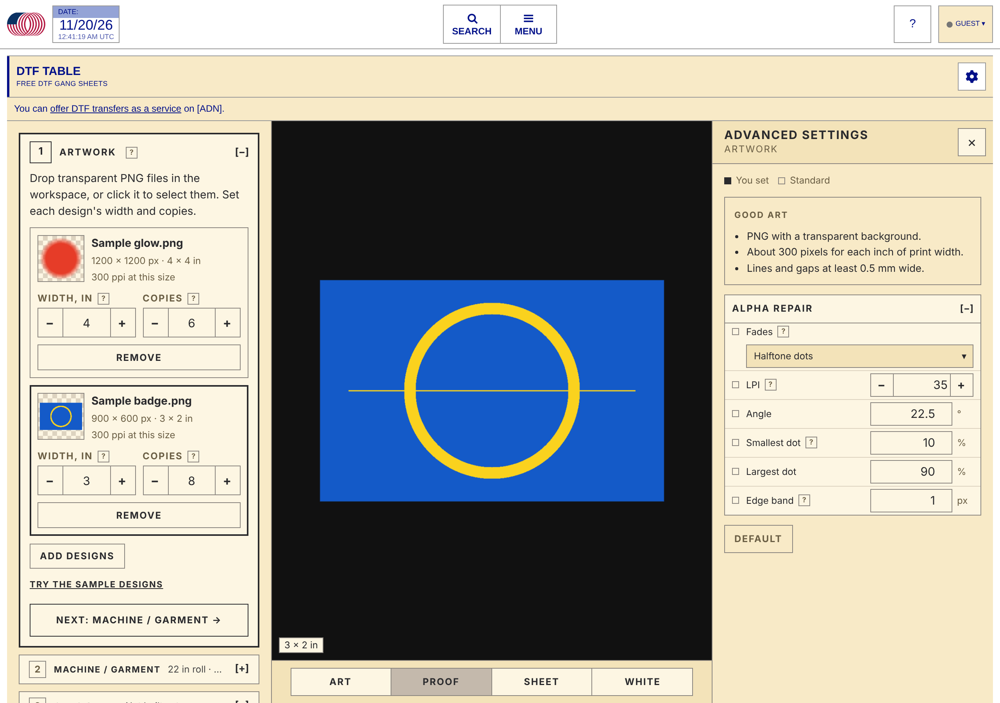

<picture>
  <source media="(prefers-color-scheme: dark)" srcset="src/assets/brand/header-dark.svg">
  
</picture>

# DTF Table

Free, open-source print-file preparation for direct-to-film (DTF)
printing. Runs in your browser.

**[Open DTF Table](https://americandreamnetwork.us/tools/printing/dtf-transfers/dtf-table)**
· MIT License · © American Dream Network

Version 0.1.0 · [Changelog](CHANGELOG.md) ·
[Release notes](releases/0.1.0.md)

## What it does

DTF Table gets art ready for your RIP. Drop your transparent PNGs,
pick your roll, and build the gang sheet. Soft edges and fades are
fixed so they print, a white layer is made and choked, and the
sheet is checked before you print. It does not drive a printer and
does not replace your RIP (CADlink, AcroRIP, Maintop, Epson Garment
Creator or others): it writes PNG, TIFF or PDF files your RIP loads.
Nothing is uploaded: the art stays in your browser tab.

<picture>
  <source media="(prefers-color-scheme: dark)" srcset="docs/screenshot-dark.png">
  
</picture>

## Features

### Art

- **Alpha repair.** DTF film cannot print a half-clear pixel. Soft
  edges are cut to in or out. Fades, glows and shadows become
  halftone dots, so they print as fades. After repair no pixel is
  half clear.
- **White layer.** White under the colour, choked so a small
  misregistration shows no white rim. Thin lines keep their white.
  Spread for a white outline, density, colours knocked out (the shirt
  shows), and colours printed with no white.

### Machine

- A 13, 22 or 24 in roll, or a custom width, longest print and file
  resolution, and how your RIP takes white. Saved in the browser.

### Gang sheets

- Designs and copies packed onto your roll width, turned where that
  saves film, split onto more sheets past the longest print.
- Written in bands of rows, so a 22 × 100 in sheet at 300 dpi (about
  800 MB as one image) never sits in memory whole.
- PNG, TIFF or PDF at size, plus a separate white file if you want
  one.

### Preflight

- Under 300 ppi at print size (under 150 is an error), too large for
  the roll, lines and gaps under 0.5 mm, and how many
  semi-transparent pixels alpha repair will fix.

## Workflows

### Art program and RIP

1. Export each design from your art program as a PNG with a
   transparent background, about 300 pixels per inch of print width.
2. Drop the files here. Set each design's width and copies.
3. Pick your roll and how your RIP takes white (step 2). Check the
   Proof and White views.
4. Build the gang sheet (step 3) and export it (step 4).
5. Load the sheet in your RIP. If your RIP takes a white file, load
   the white file with it; otherwise let the RIP make white from the
   sheet's transparency.

### Calibrate to your printer

`npm run targets -- <folder>` writes a test sheet. Print it, press
it, and measure it as [docs/TEST-TARGETS.md](docs/TEST-TARGETS.md)
says. The results set the choke, the thinnest line and the halftone
defaults for your machine.

## Run it locally

Needs Node 22 or newer.

```bash
git clone https://github.com/navruhtra/dtf-table
cd dtf-table
npm run setup   # pinned libraries and the Separation Table engine into src/vendor/
npm start       # http://localhost:8377
```

`npm run setup` downloads fflate, quickhull3d and the Separation
Table engine at the pinned commit, and checks each file against
`src/vendor.sha256`.

## Tests and benchmark

```bash
npm test             # unit tests
npm run typecheck    # tsc on the files marked @ts-check
npm run setup:bench  # once: rectpack 0.2.2 in .venv/ (Python 3)
npm run benchmark    # benchmark gate against benchmark/baseline.json
npm run setup:e2e    # once: Playwright and its Chromium into .cache/
npm run e2e          # the page in Chromium at 390 × 844 and 1280 × 800
```

| Layer | What it checks |
|---|---|
| `tests/check.mjs` | alpha repair leaves no half-clear pixel and keeps fades; the white layer's choke, spread, knockouts and misregistration |
| `tests/sheet.mjs` | machine profiles, nesting, the PNG, TIFF and PDF writers read back, preflight |
| `tests/browser.mjs` | the browser deflate (fflate) writes the same files as Node's |
| `benchmark/run.mjs` | a fixed referee on synthetic art and five gang-sheet orders, with rectpack as the nesting competitor; exit 2 when any measure is worse than the baseline |
| `tests/page.cjs` | the page at a phone and a desktop size: the layout, the sample designs, the views, the gang sheet, the download, the theme, and the page framed as on the ADN site |

CI: `.github/workflows/test.yml` runs setup, the release and notice
checks, the type check, the tests, the benchmark gate and the browser
test on every push to main and every pull request.

## Status

Version 0.1.0. On 2026-11-20 the unit tests, the type check, the
benchmark gate (no measure worse than the baseline) and the browser
test all passed.

Every quality number is a model number. No print of the test targets
has been measured yet.

## More

- [How it works](docs/ENGINE.md): the steps, the options and the
  Separation Table engine
- [Benchmark](docs/BENCHMARK.md)
- [How it compares](docs/COMPARISON.md)
- [Test targets](docs/TEST-TARGETS.md): what to print and measure
- [Publishing a release](docs/RELEASE.md)
- [Changelog](CHANGELOG.md)

## Known limits

- The defaults (35 LPI, smallest dot 10 %, 1 px choke) are a starting
  point, not measured on a printer. Until the test targets are printed
  and measured, every quality number here is a model only.
- Whether a RIP keeps a white file you supply, or makes its own,
  differs by RIP and setting. It is not checked yet.
- No colour management: colours your inks cannot reach are not
  flagged (that needs a printer profile).
- White as a spot channel inside one TIFF or PDF is not written yet.
- Designs are prepared on the page's main thread, so very large
  sheets can make the page slow to respond.

## Credits and license

MIT, Copyright (c) 2026 American Dream Network (LICENSE). The ADN
name and logo are not licensed for reuse.

To contribute, read CONTRIBUTING.md.

The colour maths, halftone dots, choke and thin-line measure come
from the [Separation Table](https://github.com/navruhtra/separation-table)
engine (MIT, American Dream Network), downloaded at a pinned commit.
Libraries keep their own licenses: THIRD-PARTY-NOTICES.md (generated
from the pins) and NOTICE (what each is for, and the published
methods the tool implements). GPL, AGPL and non-commercial code is
left out on purpose.
